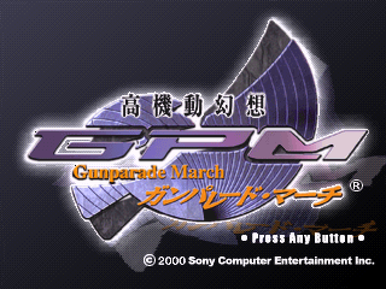
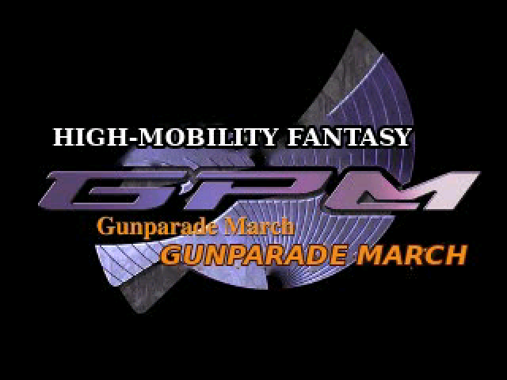
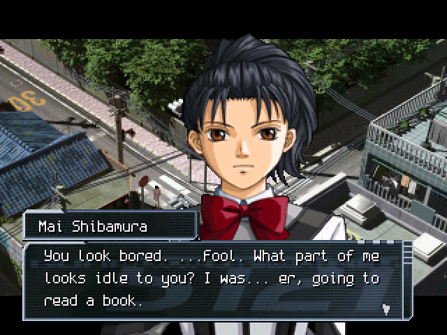
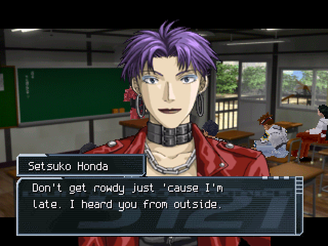
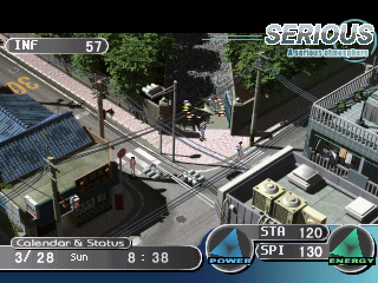
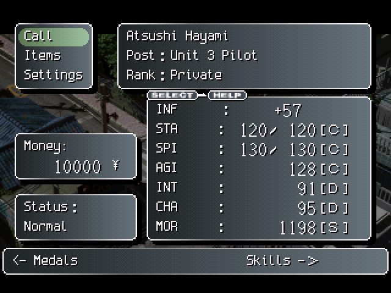
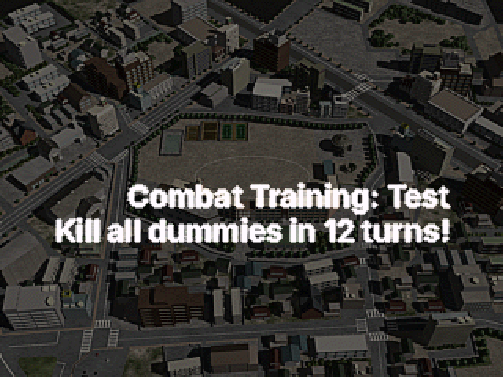
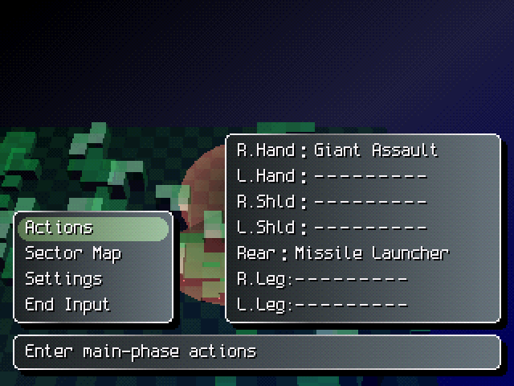

<h1 align="center">Koukidou Gensou: Gunparade March<br>English Patch (MTL)</h1>

<p align="center">
An English fan translation patch for <b>Koukidou Gensou: Gunparade March</b> (高機動幻想ガンパレード・マーチ),<br>
the 2000 PlayStation game by Alfa System / Sony Computer Entertainment (Japan, SCPS-10136).
</p>

<p align="center">
<a href="../../releases/latest"><b>⬇ Download the latest release (v2.0)</b></a>
&nbsp;·&nbsp; <a href="#how-to-apply">How to apply</a>
&nbsp;·&nbsp; <a href="#changelog">Changelog</a>
&nbsp;·&nbsp; <a href="../../issues">Report a problem</a>
</p>

<p align="center"> </p>

## Screenshots

| | |
|:---:|:---:|
|  |  |
| Conversations | Story events |
|  |  |
| School life | Status screen |
|  |  |
| Combat training | Battle commands |

## About this translation

This is an **independent, machine-assisted (MTL) translation**, made from scratch from the original Japanese disc. It uses its own translation scripts and custom tools to handle the event archive, the program overlays and the font. It is not based on any other translation.

> [!NOTE]
> This project is **not related to Asterhex's human translation** of Gunparade March, which is a separate project. For human-quality English, that translation is the better choice:
> **https://github.com/phukyes/Gunparade-March-English**

Because this is a machine-assisted translation, expect some awkward phrasing and the occasional mistranslation. Bug reports are welcome.

## What's translated

- All story events and conversations (1,183 event scripts)
- Menus, status screens, the bulletin board, skills and messages
- Battle screens, the tutorial and battle menus
- Map and location names
- In-game graphics and labels
- A new English font with letter pairs, so more text fits in each box

Some long names and labels are shortened to fit the game's fixed-size boxes (for example "H. Yoshino" on the bulletin board, and 4-letter skill names on the Skill List). A few hidden developer/debug screens are still in Japanese.

## How to apply

> [!IMPORTANT]
> You need your own disc image of the Japanese release, as a single `.bin` + `.cue`. **No game data is included or distributed here.**

| Original image | |
|---|---|
| File | `Koukidou Gensou - Gunparade March (Japan).bin` |
| Size | 440,372,016 bytes |
| MD5 | `66709F78ABFDC5A4CC40A8A47C274441` |
| SHA-1 | `1FD53D0FCDC2D9C8FA61E5640206B78A5E0ED0ED` |

This matches the Redump dump. If your image doesn't match, the patch won't apply.

1. Download the release zip from the [Releases](../../releases) page.
2. Apply the `.xdelta` patch to your `.bin` with any xdelta patcher:
   - In a browser: [ROM Patcher JS](https://www.marcrobledo.com/RomPatcher.js/)
   - Windows: Delta Patcher or xdelta UI
   - Command line:
     ```
     xdelta3 -d -s "Koukidou Gensou - Gunparade March (Japan).bin" "Gunparade March (English v2.0).xdelta" "Gunparade March (English v2.0).bin"
     ```
3. Keep the patched `.bin` next to the included `.cue`, and load the `.cue` in your emulator.

## Compatibility

- Tested in PCSX-ReARMed. It should work in DuckStation and other accurate emulators.
- Memory card saves work normally. Emulator save states from a different patch version won't.

> [!TIP]
> **SwanStation (including PS5):** if you see noise or garbage in the right half of dialogue boxes, turn on anti-aliasing (MSAA) or set the GPU renderer to Software in Core Options. This is an emulator rendering quirk, not a problem with the patch.

## Testing

Each release is checked by:
- loading every one of the 1,183 event scripts in an emulator and comparing the result against the original Japanese disc;
- long automated play sessions (menus, school days, battles, dialogue) that watch for freezes;
- for v1.2, a played-through game from the first day to mid-May on an automated pilot, and screen-by-screen checks of the menus and windows.

Found a freeze, a crash or untranslated text? Please [open an issue](../../issues) with the in-game date, where you were and a screenshot if you can.

## Changelog

### v2.0
- Names with an odd number of letters no longer leave a half-cell gap after them ("Iwata , Mai", "Yoshino  became"). The text printer now advances only part of a cell after the padded last letter, so inserted names, coloured words and values sit next to the following text. Numbers inserted into sentences are no longer spread out ("Love +1 5 ," now reads "Love +15,").
- The Alfa System logo movie and the title logo at the end of the opening movie are in English (re-encoded movie frames).
- Lesson results ("Also, Tanabe got thrown out of class.") and the ending captions with the player's name and rank are cleaned up.
- Bulletin board: "Line Officer Roster" / "Techno Officer Roster" titles, plus several roster and notice lines corrected and re-broken.
- Proposal menu: "Strategy meeting!" and "Let's all try hard" were too long for their menu box and wrapped onto extra lines. They are now "Strategy meeting" and "Let's try hard!"; three other long proposal names were shortened the same way.
- Natural-English pass: every dialogue line was read twice more for how it sounds, and about 4,650 lines were reworded. Stock translationese ("It can't be helped", "Is that so?") is replaced with what each character would actually say, stiff word order is loosened, banter is sharper, and the teenagers get period-appropriate slang. Character voices stay distinct: Mai formal and without contractions, Yoko's gentle broken English, Mibuya prim, the Kumamoto drawl, and Mori's country dialect when she slips into it.
- Screen fixes: the meeting order table lines up; the gear menu items fit their box ("Swap Unit", "Swap Arms", "Swap Dress", "Weapons"); "Comms" is now "Comm"; the maintenance training result and the black market "(Unpaid)" tag have their missing spaces; the platoon supplies wardress page keeps its count column straight.
- Proposals: the first prompt ("Propose with what tone?") now fits its box; it used to be too long, so only its "?" was shown. A battle radio line no longer wraps mid-word, the black market register lines have their spaces, and the pilot work detail colons line up.
- More screen fixes: the school store's pencil and notebook descriptions sit under the right items (a mix-up from the original game), the shop price line has its space, the Shikon Status header sits over its columns, and the job-start prompts were shortened to fit their boxes.
- Bug sweep of battles: the hit and part-damage report is on two lines with no word cut; the manual equip prompts read "Draw Wpn: cancel" instead of showing stray brackets; the KIA line reads "Yohei Takigawa (Corporal) KIA!"; radio orders put the name last ("Cover our retreat, Moe"); dropped-weapon and retreat lines have their spaces; the Actions list number boxes show full numbers; three stage-direction lines no longer show junk glyphs; one word that was still Japanese ("Infantry") is translated.
- The day-end Gear Maintenance report has its labels separated and columns lined up; the job "Effect" line and the "can't work" line fit their boxes.
- Late sweep: the battle supply-point and retreat-point prompts were cut down to "nt." and now read whole ("At the supply point." / "Resupply?"); the Duties screens show their rating grade on the header line; the training "gains so far" numbers no longer sit under the rank markers; two proposal pop-ups no longer have their last letters hidden by the box arrow; the day-end report page titles have their space ("Operator Info").
- Three lines that printed the wrong text because one code reference to each had been missed: the reaction after a turned-down proposal showed "atched" instead of "...Curse you!", and a battle counter-slash prompt and a "That character isn't here." message pointed at other lines. The shift-change and transfer notices no longer double up punctuation after "Mech." post names.
- Bug sweep of menus: the petition radio's request lines fit and its promote/reassign lists show surnames instead of wrapping long names; the war status map's "Higashi-Airport" sector name fits; the group morale result and three mood messages have their missing spaces; the black market's two-item register line fits its box.
- Saves made with early versions of the patch show a clipped name on the load screen until you save again.
- Final full re-read of the whole script against the Japanese (17,595 event blocks and about 27,000 menu, chatter and battle lines): 34 real mistranslations and about 250 smaller wording problems fixed. The ending captions no longer leave a gap before punctuation after the player's name.

<details>
<summary><b>Older versions (v0.7 to v1.2.2)</b></summary>

#### v1.2.2
- Quality inspection pass: every event script and every menu, chatter and proposal line re-read against the Japanese twice, with reviewers checking each other's work. About 2,000 lines improved (mistranslations, character voice, gender-neutral player address, consistent menu names, typos).
- No more double spaces before inserted names and places in most text ("let's go to  Ajinoren" is fixed).
- Text boxes break more naturally (no one-word leftover boxes; numbers stay with their units).
- The relationship-up name box is also fixed in normal play; the gaze prompt, bond-up message and impression prompt read cleanly.
- Side-story date captions use one format; chatter stage directions use one tense; the prologue and endings got a final polish.

#### v1.2.1
- Relationship-up window: the partner name box is wider, so long names show in full ("<-Higashihara" instead of "ihara").
- In-game manual (the Library's "How to..." books): removed stray gaps before brackets and full stops after highlighted words.
- Checked on screen: the policy meeting, the class schedule board, the combat training tutorial, the help books, the court-martial game over, and the end-of-game epilogue and staff credits.
- Known issue: names with an odd number of letters are followed by a small gap when inserted into a sentence ("Iwata , Mai"). This comes from the two-letters-per-cell font and can't be fixed with text changes alone.

#### v1.2
- Translation refinement: the whole script was re-read against the Japanese; about 700 lines improved in events, chatter and system text (mistranslations, speaker voice, gender-neutral address for the player, consistent battle terms).
- Event dialogue that continued into an extra text box (voiced lines) is now in English.
- More graphics in English: Manual-mode stat tags, mood banners, the maintenance header, battle tutorial slides, the schedule and the ending rank screen, among others.
- Full names no longer overflow or get cut off in the "Where is...?" list, the Heart Map, status window headers, the lesson partner list, the officer roster, the socks page, the post-clear Character Select and memory card save titles.
- "End the day. OK?" on the area map, the Sock Hunter episode title cards and the battle sector platoon pop-up are now in English.
- Policy meeting: the "Call on whom?" vote list now shows short names on one row each, and the armour-type agenda choices fit their menu.
- Known issues: in very long games (about 90+ battles by May, e.g. taking Honda's field test daily) a battle can stop on a "maphit.cc ... Illegal Char ID:255" debug screen. This is a memory leak in the original game (it happens on the Japanese disc too); reload your day save.

#### v1.1
- Fixed the endings: in v1.0.1 the ending epilogues and the staff roll could not finish (the text ran past its end, then the game froze or crashed). The patch tools had damaged the control codes that end each ending text. All endings now play through to the title screen. The history epilogue ("Sep. 1999: ...") is now in English too.
- Translation refinement: about 760 lines in events, chatter, proposals and menus re-checked against the Japanese and improved.
- 51 event pictures with Japanese writing on them are now in English.
- Text that didn't fit its box now does: title screen memory card messages, the "Ditchside Path" location label, the gaze prompt, the relationship-up message and list, the battle kill message, the battle action confirmation and the shop price line.
- Save files are titled "File1 <name> 3/13" in the Load list (saves from older versions keep their Japanese title).
- Coloured words no longer leave a double gap after them; six untranslated weapon names on the maintenance screen are translated.

#### v1.0.1
- Fixed a freeze in the hangar when changing a Shikon's weapon with the cursor on the Giant Bazooka (present since v0.7). The patch had overwritten the bazooka's item number in the maintenance weapon table.
- Fixed "de" showing up as "..." in some text (item descriptions such as the Adelaide Assault Rifle, conversations, proposals, battle messages). The game draws one particular byte as an ellipsis, and the patch had been using it for the letter pair "de".

#### v1.0
- Full review of the whole script: every event and all menu, battle, conversation and proposal text re-checked against the Japanese. About 470 lines fixed (meaning errors, wrong speakers, flipped negations, typos, stiff phrasing).
- Names and terms made consistent between events and menus (Shikon tuning stats, "Leap", "Barrage", "Class Rep", the Gunparade March song refrain, Akira's name in item names).
- Fixed line breaks in the Shikon Unit selection and work results menus.

#### v0.9.1
- Maintenance screen: removed a stray text code in front of "SMG" in the weapon list.
- Maintenance screen: the 40mm anti-aircraft gun was mislabeled "20mm".
- Checked every translated file against the memory it loads into; all fit.

#### v0.9
- Shortened two NPC chatter files to fit the game's memory limit, with a build check for all chatter files.

#### v0.8
- Fixed two story events that could freeze the game.
- Bulletin board name boxes now show readable short names instead of cut-off fragments.
- The Skill List grid now lines up, using 4-letter skill names.
- Translated some debug menus that were still in Japanese.

#### v0.7
- First public release.

</details>

## Translation source

The full translation source (every Japanese line next to its English) is in `gpm_translation_source.zip` in this repo.

## Legal

This is an unofficial fan project, not affiliated with or endorsed by Sony Interactive Entertainment or Alfa System. Gunparade March and all related names belong to their respective owners. Only patch files are distributed; please don't ask for, or share, disc images.
